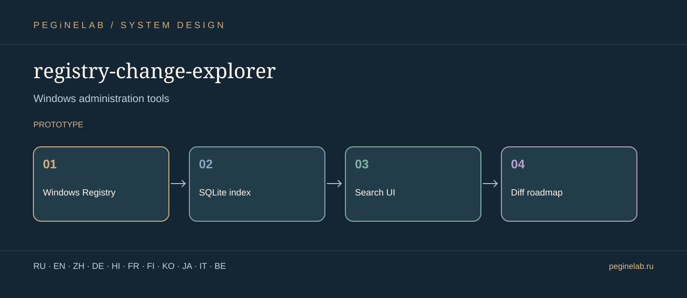

# registry-change-explorer — Visual project presentation

**Инструменты системного администрирования Windows · Windows administration tools**

**Project flow:** Windows Registry → SQLite index → Search UI → Diff roadmap. **Status:** prototype.

**Translations:** documentation showcase only; interface localization and actual device tests are described independently in this project's README.

### Русский · ru
Поиск и исследование реестра Windows с локальным индексом SQLite.. **registry-change-explorer:** Windows Registry → SQLite index → Search UI → Diff roadmap.

### English · en
Explore the Windows Registry with a local SQLite search index.. **registry-change-explorer:** Windows Registry → SQLite index → Search UI → Diff roadmap.

### 简体中文 · zh
借助本地 SQLite 索引探索 Windows 注册表。. **registry-change-explorer:** Windows Registry → SQLite index → Search UI → Diff roadmap.

### Deutsch · de
Windows-Registrierung mit lokalem SQLite-Suchindex erkunden.. **registry-change-explorer:** Windows Registry → SQLite index → Search UI → Diff roadmap.

### हिन्दी · hi
स्थानीय SQLite सूचकांक से Windows रजिस्ट्री की खोज।. **registry-change-explorer:** Windows Registry → SQLite index → Search UI → Diff roadmap.

### Français · fr
Explorer le registre Windows avec un index SQLite local.. **registry-change-explorer:** Windows Registry → SQLite index → Search UI → Diff roadmap.

### Suomi · fi
Windows-rekisterin tutkiminen paikallisen SQLite-hakuindeksin avulla.. **registry-change-explorer:** Windows Registry → SQLite index → Search UI → Diff roadmap.

### 한국어 · ko
로컬 SQLite 검색 색인으로 Windows 레지스트리 탐색.. **registry-change-explorer:** Windows Registry → SQLite index → Search UI → Diff roadmap.

### 日本語 · ja
Windows 管理ツール. **registry-change-explorer:** Windows Registry → SQLite index → Search UI → Diff roadmap.

### Italiano · it
Strumenti di amministrazione Windows. **registry-change-explorer:** Windows Registry → SQLite index → Search UI → Diff roadmap.

### Беларуская · be
Інструменты адміністравання Windows. **registry-change-explorer:** Windows Registry → SQLite index → Search UI → Diff roadmap.

## Контакты / Contact

Telegram: [@Feudorlab1](https://t.me/Feudorlab1) · Phone: [+7 926 041 1145](tel:+79260411145)

Email: [feudor.lab@yandex.ru](mailto:feudor.lab@yandex.ru), [obzorniky@gmail.com](mailto:obzorniky@gmail.com) · [peginelab.ru](https://peginelab.ru/)

[Repository](https://github.com/musikfed/registry-change-explorer) · Technical README is authoritative; experimental features are not certified.
